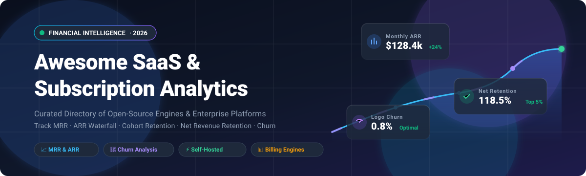

  

# 📈 Awesome SaaS & Subscription Financial Analytics 🚀

**A curated list of top SaaS and subscription financial analytics platforms, revenue engines, and open-source tools.**  
*Track MRR, ARR Waterfall, Churn, LTV, CAC Payback, Cohort Retention, and the financial health of recurring-revenue business models.*

 

---

## 📑 Table of Contents 🧭

- [🌐 Sector Overview & Market Dynamics](#-sector-overview--market-dynamics)
- [🟦 SaaS / Hosted Commercial Platforms](#-saas--hosted-commercial-platforms)
- [🟩 Open-Source Software & Metric Engines](#-open-source-software--metric-engines)
- [📊 Feature Comparison Matrix](#-feature-comparison-matrix)
- [📈 Star History](#-star-history)
- [🤝 Contributing](#-contributing)
- [💖 Support & Sponsorship](#-support--sponsorship)
- [📄 License](#-license)

---

## 🌐 Sector Overview & Market Dynamics 📊

The global subscription billing management and recurring revenue analytics market was valued at **$7.5B in 2024** and is projected to reach **$18B+ by 2030** (CAGR ~16%). The landscape is **moderately fragmented**—anchored at the infrastructure layer by large recurring payment ecosystems (e.g., Stripe, Chargebee, Zuora), while leaving significant room for specialized subscription analytics suites, churn intelligence, and open-source metric computation engines.

---

## 🟦 SaaS / Hosted Commercial Platforms 🏢

Commercial cloud-hosted SaaS and subscription financial analytics platforms for investor-grade metric calculation, cohort retention analysis, and revenue reconciliation. *Sorted by company valuation/revenue in descending order.*

| Platform | Company Scale / Valuation | Pricing (Starting Paid Tier) | Free Tier Limits / Trial | Primary Strengths & Metrics |
|:---|:---|:---|:---|:---|
| **[Stripe Sigma](https://stripe.com/sigma)** 💳 | **$159B Valuation** (~$6.9B+ Annual Net Revenue) | **$10/month** (annual contract for up to 250 charges; overage $0.04/charge) or **$15/month** billed monthly | **30-day free trial** with full access to SQL queries and AI assistant | SQL-first analytics directly on Stripe data; AI query generator; custom reporting on MRR, refunds, and cohort retention. |
| **[Chargebee Analytics](https://www.chargebee.com/)** ⚡ | **$3.5B Valuation** ($200M+ Annual Revenue) | **$599/month** (Performance Plan billed annually at $7,188/yr, covers up to $100K/mo MRR + 0.75% overage) | **Free Starter plan** up to **$250,000 cumulative lifetime billing** (0.75% fee after limit) | 360° subscription reporting explorer, ASC 606 revenue recognition, trial-to-paid conversion, and churn alerts. |
| **[ProfitWell Metrics](https://www.profitwell.com/)** 🎯 | **$200M+ Acquisition** (Acquired by Paddle; $10M+ ARR) | **Free Core Analytics** ($0/month; monetized via paid Retain, Recognized & Pricing add-ons) | **100% Free Forever with unlimited ARR & team seats** | Zero-cost investor-grade analytics, industry benchmarks from 15,000+ companies, MRR trends, and cohort retention. |
| **[Maxio Insights](https://www.maxio.com/)** 💼 | **$169M+ Funding** ($17B+ managed ARR across 2,000+ B2B customers) | **$599/month** (Grow Plan for up to $100K in monthly billings) | **Free Build sandbox tier** for API/SDK test workflows; no production time-limited free trial | AI-driven financial analyst agents explaining ARR bridges, close readiness, and discount-to-churn correlations. |
| **[Baremetrics](https://baremetrics.com/)** 📉 | **$4M Acquisition** (Acquired by Xenon Partners; ~$1.5M ARR) | **$49/month** (Launch tier for up to $360K ARR, billed annually) | **14-day free trial** with full platform access (no permanent free tier) | 28+ pre-built SaaS metrics (MRR, ARR, churn, upgrades), benchmark comparisons, and payment recovery add-ons. |
| **[ChartMogul](https://chartmogul.com/)** 📊 | **$7M+ Annual Revenue** ($3.7M total funding; 50+ employees) | **$57/month** (Starter tier for ARR above $120K; scales based on ARR) | **Free forever plan** up to **$10,000 MRR ($120,000 ARR)** with core metrics and 1 billing sync | Standardized SaaS metric engine, CRM revenue view, multi-billing aggregation, and warehouse export sync. |

---

## 🟩 Open-Source Software & Metric Engines 💻

Self-hosted, transparent, and community-driven analytics engines, usage metering platforms, and metric calculation frameworks for subscription businesses. *Sorted by GitHub Stars_Count in descending order.*

| Tool | GitHub_Stars | Stack | License | Description & Key Capabilities |
|:---|:---:|:---|:---|:---|
| **[Lago](https://github.com/getlago/lago)** 🦩 |  | Ruby / Go / TypeScript | AGPL-3.0 | Open-source metering, usage-based billing, and revenue analytics engine designed as an alternative to Stripe Billing and Chargebee. |
| **[Kill Bill](https://github.com/killbill/killbill)** 🥷 |  | Java / MySQL / PostgreSQL | Apache-2.0 | Battle-tested, enterprise open-source subscription billing, payment management, and financial analytics platform. |
| **[OpenMeter](https://github.com/openmeterio/openmeter)** ⏱️ |  | Go / ClickHouse / Kafka | Apache-2.0 | Real-time usage metering and billing infrastructure for AI, APIs, and SaaS with high-throughput event ingestion and analytics. |
| **[Tier](https://github.com/tierrun/tier)** 🏷️ |  | Go | Apache-2.0 | Pricing and billing engine providing clean pricing models, metering primitives, and subscription management for modern SaaS. |
| **[Pulse](https://github.com/mike-paper/pulse)** 💓 |  | TypeScript / Next.js | MIT | Lightweight open-source SaaS metrics dashboard tracking MRR, ARR, active subscriptions, and customer lifecycle insights. |
| **[Profitable](https://github.com/rameerez/profitable)** 💰 |  | Ruby on Rails | MIT | Rails engine calculating MRR, ARR, TTM, churn, LTV, ARPU, total revenue, and startup valuation directly from payment webhooks. |
| **[Powernode Platform](https://github.com/nodealchemy/powernode-platform)** ⚡ |  | Rails 8 / React / PostgreSQL | MIT | Subscription management platform with native MRR/ARR calculations, churn analytics, and multi-gateway billing integration. |
| **[saas-metrics](https://github.com/Skippy-8/saas-metrics)** 📐 |  | Python / DuckDB / Excel | MIT | Deterministic SaaS revenue accounting engine featuring service-period spreading, auditable live Excel formulas, and waterfall reconciliations. |
| **[ChurnLens](https://github.com/kindrat86/churnlens)** 🔍 |  | Python / Docker | Source-Available | Self-hosted revenue-quality and churn-risk calculator computing MRR, customer churn, and cohort retention from CSV billing exports. |

---

## 📊 Feature Comparison Matrix ⚖️

| Solution | Deployment | License | Primary Focus | Best For |
|:---|:---:|:---:|:---|:---|
| **Stripe Sigma** 💳 | Cloud SaaS | Proprietary | SQL / Data Warehouse Queries | Stripe-native teams wanting total query flexibility |
| **Chargebee Analytics** ⚡ | Cloud SaaS | Proprietary | Invoicing, Billing & RevRec | Scaling businesses with complex subscription billing |
| **ProfitWell Metrics** 🎯 | Cloud SaaS | Free Proprietary | Free Benchmarks & MRR | Startups needing 100% free investor metrics |
| **Maxio Insights** 💼 | Cloud SaaS | Proprietary | AI Financial Analysis & CPQ | Mid-market B2B SaaS with heavy RevRec requirements |
| **Baremetrics** 📉 | Cloud SaaS | Proprietary | Core Analytics & Dunning | Founders wanting plug-and-play dashboards |
| **ChartMogul** 📊 | Cloud SaaS | Freemium Proprietary | Metric Standardization & CRM | Multi-gateway metric consolidation & CRM sync |
| **Lago** 🦩 | Self-Hosted | AGPL-3.0 | Metering & Consumption Billing | Modern SaaS building hybrid or usage-based pricing |
| **Kill Bill** 🥷 | Self-Hosted | Apache-2.0 | Enterprise Billing Orchestration | Large enterprises needing an open billing framework |
| **OpenMeter** ⏱️ | Self-Hosted | Apache-2.0 | High-Volume AI & API Metering | AI token tracking and usage aggregation at scale |
| **saas-metrics** 📐 | Self-Hosted | MIT | Auditable Excel & FP&A Engine | Finance teams demanding formula-level transparency |

---

## 📈 Star History 🌟

---

## 🤝 Contributing 💡

Contributions are warmly welcomed! 🌟 If you know of an open-source SaaS financial analytics tool, billing engine, or metric framework that should be included:

1. 🍴 Fork the repository.
2. 🌿 Create your feature branch (`git checkout -b feature/awesome-tool`).
3. 💾 Commit your changes (`git commit -m 'Add awesome tool'`).
4. 🚀 Push to the branch (`git push origin feature/awesome-tool`).
5. 📬 Open a Pull Request.

Please check that open-source tools have an active repository and include clear documentation on metric calculation methods.

For other curated lists of high-quality tools and projects, visit [Awesome-Awesome-Awesome](https://github.com/ishandutta2007/Awesome-Awesome-Awesome).

---

## 💖 Support & Sponsorship 🙏

Thank you for exploring and utilizing this curated guide to SaaS & Subscription Financial Analytics! If this repository helped you discover the right tool, improve your revenue observability, or streamline your financial metrics, please consider supporting the project:

- ⭐ **Star this repository** to help others discover it on GitHub!
- 🍴 **Fork and share** with your network, team, and fellow founders!
- ☕ **Buy a coffee & sponsor ongoing maintenance:** [Sponsor Dashboard on GitHub](https://github.com/sponsors/ishandutta2007)

Your support keeps this directory updated, accurate, and comprehensive for the entire SaaS community! ✨

---

## 📄 License 📜

This collection is licensed under the [Creative Commons Zero v1.0 Universal](LICENSE) (CC0 1.0 - Public Domain). Individual projects and platforms retain their respective licenses and terms of service.
